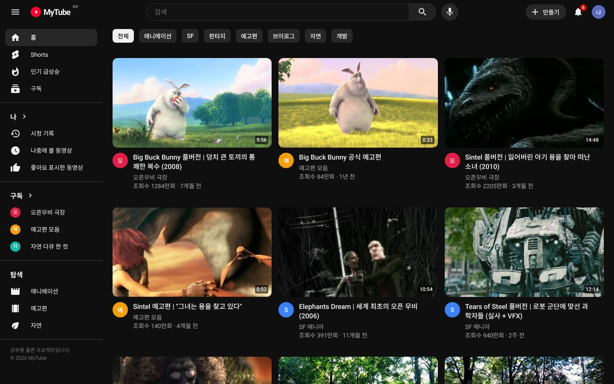
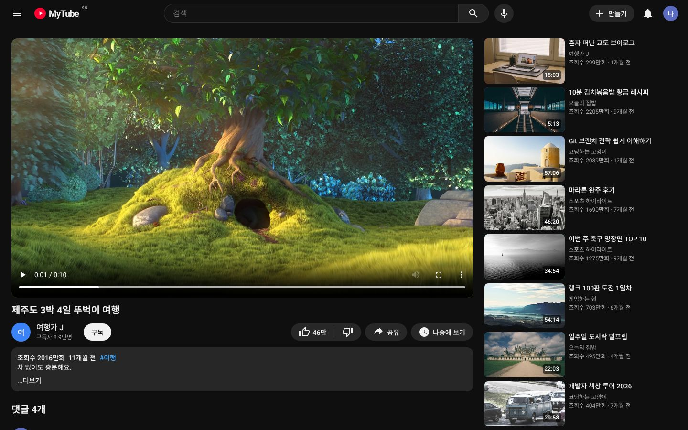
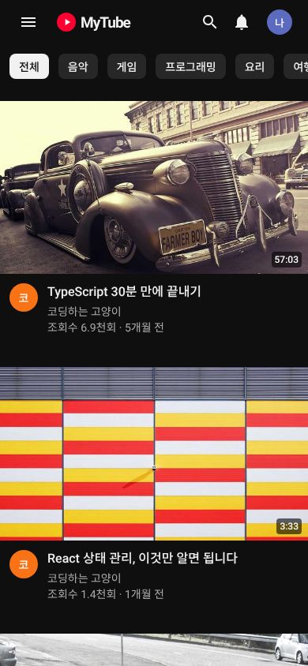
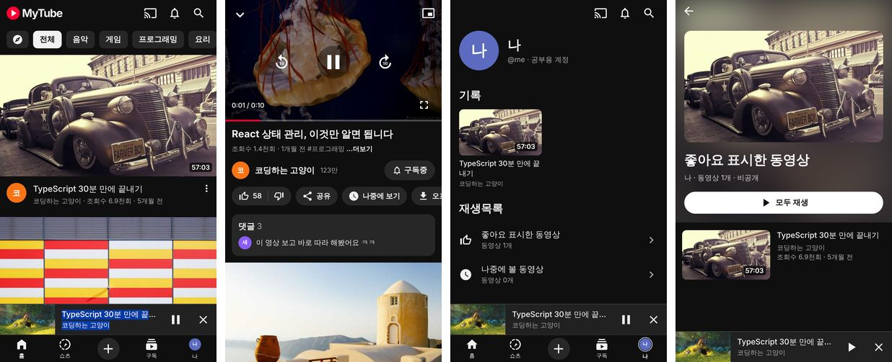

# MyTube — 공부용 영상 앱 클론

YouTube처럼 동작하는 영상 앱을 **서버 없이** 만들어 보는 학습 프로젝트예요.
**웹 앱**과 **iOS·안드로이드 앱**이 같은 핵심 코드(`packages/core`)를 함께 써요.







## 실행 방법

```bash
npm install          # 저장소 루트에서 한 번
npm run dev:web      # 웹 앱: http://localhost:5173
npm test             # core 로직 자동 테스트
```

모바일 앱(아이폰·안드로이드) 실행 방법은 [apps/mobile/README.md](apps/mobile/README.md)에 있어요.



## 기술 스택

- **TypeScript**: youtube.com도 JavaScript/TypeScript로 만들어져 있어요.
- **웹**: React + Vite
- **모바일**: React Native + Expo SDK 58 (expo-router, expo-video)
- **npm workspaces**: 저장소 하나에 여러 앱과 공용 패키지를 함께 관리해요(모노레포).

## 폴더 구조

```
packages/
  core/      순수 TypeScript — 타입, 데이터 서비스, 검색 규칙, 전역 상태(userStore, playerStore), 저장소 약속
  hooks/     React 훅 — useAsync, useUserState, usePlayerState (웹·모바일 공용, DOM/네이티브 없음)
apps/
  web/       웹 앱 (React DOM + CSS)
  mobile/    iOS·안드로이드 앱 (React Native + Expo)
docs/        단계별 설명(STAGES.md), 요청 체크리스트(CHECKLIST.md), 스크린샷
```

## 아키텍처 한눈에 보기

```
화면 층   (apps/web, apps/mobile)  플랫폼마다 따로 만듦
   ↓ 요청만 함
서비스 층 (packages/core)        화면이 데이터를 얻는 유일한 창구 (웹·모바일 공용)
   ↓
데이터 층 (packages/core/data)   지금은 가짜 데이터, 나중엔 서버 API
```

- 위층은 바로 아래층만 알고, 아래층은 위층을 몰라요.
- 서버를 붙일 때는 서비스 층 안쪽만 바꾸면 되고, 모바일로 옮길 때는 화면 층만 새로 만들면 돼요.
- 모든 기능은 **상태 → 요청 → 응답 → 다시 그리기** 흐름으로 동작해요.

단계별 자세한 설명은 [docs/STAGES.md](docs/STAGES.md), 요청 진행 상황은 [docs/CHECKLIST.md](docs/CHECKLIST.md)에 있어요.

## 개발 로드맵

- [x] **1단계**: 레이아웃(헤더·사이드바), 홈 영상 그리드, 카테고리 필터
- [x] **1.5단계**: YouTube 다크 모드 디자인 (레이아웃·색·크기 맞춤, Material 아이콘, 반응형)
- [x] **2단계**: 영상 시청 페이지 (라우팅, 비디오 플레이어, 추천 영상 목록)
- [x] **3단계**: 검색 기능 (자동완성, 결과 페이지, 테스트)
- [x] **4단계**: 좋아요, 댓글, 구독 (저장소 추상화 + 전역 상태)
- [x] **5단계**: 시청 기록, 좋아요/나중에 볼 재생목록, 구독 피드, 인기 급상승, 채널 페이지, 테마 전환
- [x] **6단계**: iOS·안드로이드 앱 (YouTube iOS 앱 UI, 미니 플레이어, PiP, 백그라운드·잠금 화면 재생)

## 주요 화면과 주소

| 주소 | 화면 |
|---|---|
| `/` , `/?category=게임` | 홈 (카테고리) |
| `/watch/v1` | 시청 페이지 (구독, 좋아요, 댓글) |
| `/results?search_query=요리` | 검색 결과 |
| `/feed/trending` · `/feed/subscriptions` · `/feed/history` | 인기 급상승 · 구독 · 시청 기록 |
| `/playlist?list=LL` · `/playlist?list=WL` | 좋아요 표시한 동영상 · 나중에 볼 동영상 |
| `/channel/c1` | 채널 페이지 |

사용자 데이터(구독, 좋아요, 댓글, 기록, 테마)는 브라우저 localStorage에 저장돼요. 서버는 없어요.

## 데이터 출처

- 영상: test-videos.co.uk의 오픈 라이선스 샘플 영상 (Big Buck Bunny, Sintel 등)
- 썸네일: picsum.photos 무료 사진
- 샘플 영상은 실제로는 10초짜리예요. 카드에 표시되는 재생 시간은 가짜 데이터예요.
- 아이콘: Google Material Icons (Apache 2.0)
- 로고와 이름(MyTube)은 YouTube 상표와 구분되도록 따로 만들었어요.
