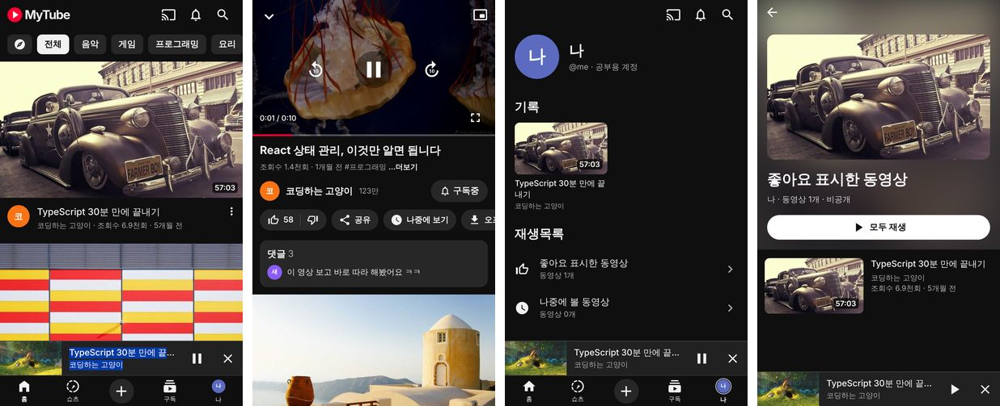

# MyTube 모바일 앱 (iOS · Android)

YouTube iOS 앱 스타일의 모바일 앱이에요. **Expo SDK 58**(React Native)로 만들었어요.
웹 앱과 같은 `@mytube/core`, `@mytube/hooks` 패키지를 그대로 써요.



## 영상·썸네일 서버 주소 설정 (처음 한 번)

앱은 썸네일과 스트리밍 영상을 웹 개발 서버에서 받아요.
1. PC에서 저장소 루트 폴더로 가서 `npm run dev:web:lan`을 실행해요. 화면에 나오는 `Network: http://192.168.x.x:5173` 주소를 확인해요.
2. `apps/mobile/.env.example`을 복사해 `apps/mobile/.env`를 만들고 그 주소를 적어요.
   - 안드로이드 에뮬레이터는 `http://10.0.2.2:5173`이 PC를 가리켜요.
   - 실제 폰은 PC와 같은 와이파이에 연결하고, 위의 `192.168.x.x` 주소를 적어요.

## 기능

- 하단 탭: 홈 · 쇼츠(준비 중) · 만들기(+) · 구독 · 나
- 앱 맨 위층에 플레이어가 하나만 있어요. 영상을 아래로 끌거나 ⌄ 버튼을 누르면 탭 바 위 **미니 플레이어**로 접혀요. 다른 탭을 보는 동안에도 영상이 계속 재생돼요.
- YouTube 스타일 자체 컨트롤: 재생/일시정지, 10초 앞/뒤, 진행 막대, PiP, 전체 화면
- 설정 시트: 화질(자동 / 1080p~144p), 재생 속도(0.25~2배)
- 적응형 스트리밍: 안드로이드 DASH(AV1/H.264 + Opus/AAC), 아이폰 HLS(H.264 + AAC 48kHz)
- **PiP**: 컨트롤의 PiP 버튼을 누르거나, 재생 중에 홈 화면으로 나가면 자동으로 작은 창이 떠요.
- **백그라운드 재생**: 다른 앱을 쓰거나 화면을 잠가도 소리가 계속 나와요.
- **잠금 화면 / 제어 센터**: 영상 제목, 채널명, 썸네일과 재생 컨트롤이 표시돼요.
- 좋아요, 구독, 댓글, 시청 기록, 나중에 볼 동영상, 테마 — 웹과 같은 로직이고, 기기에 저장돼요(AsyncStorage).

## Mac이 없을 때 (Windows 컴퓨터)

**가상 머신에 macOS를 설치하는 방법은 쓰지 않아요.**
- Apple 라이선스는 macOS를 **Apple 하드웨어에서만** 가상화하도록 허용해요. Windows PC의 VMware·VirtualBox에 macOS를 설치하는 건 라이선스 위반이에요.
- 기술적으로도 불안정해요. 그래픽 가속이 없어 Xcode와 시뮬레이터가 매우 느리고, 아이폰 USB 연결과 서명이 자주 실패해요.
- 이 클라우드 작업 환경도 리눅스라 macOS를 돌릴 수 없어요.

**대신 쓸 수 있는 합법적인 방법**

| 방법 | 비용 | 할 수 있는 것 |
|---|---|---|
| ① **안드로이드로 먼저 개발** | 무료 | Windows + Android Studio(에뮬레이터) 또는 안드로이드 폰 USB 연결. PiP·백그라운드·잠금 화면 재생까지 전부 확인 가능 |
| ② **Expo Go 앱** (아이폰) | 무료 | 화면과 기본 재생 확인. PiP·백그라운드는 안 됨 (개발 빌드가 필요해서) |
| ③ **EAS Build** (Expo의 클라우드 Mac에서 빌드) | Apple 개발자 프로그램 연 $99 + EAS 무료 요금제(월 빌드 횟수 제한) | Mac 없이 iOS 앱을 만들어 내 아이폰에 설치(내부 배포) 또는 TestFlight. PiP·백그라운드 전부 확인 가능 |
| ④ **클라우드 Mac 대여** (MacinCloud, AWS EC2 Mac, Scaleway 등) | 시간·일 단위 요금 | 원격으로 Xcode 사용. 단, 내 아이폰을 USB로 연결할 수 없어서 결국 ③처럼 개발자 계정이 필요 |

**추천 순서:** ①로 모든 기능을 안드로이드에서 먼저 완성하고 확인해요. 아이폰 확인이 필요해지면 ③(EAS Build + 개발자 계정)으로 넘어가요.

```bash
# ③ EAS Build 예시 (apps/mobile 폴더에서)
npx eas-cli@latest login
npx eas-cli@latest build:configure
npx eas-cli@latest build --platform ios --profile development   # 클라우드에서 빌드 → 아이폰에 설치 링크
```

## Mac에서 실행하기

> PiP와 백그라운드 재생은 앱 설정(Info.plist)을 바꿔야 해서 **Expo Go 앱으로는 확인할 수 없어요.**
> 아래처럼 "개발 빌드"를 직접 만들어 실행해야 해요.

### 0. 준비 (처음 한 번)

1. App Store에서 **Xcode**를 설치하고 한 번 실행해서 추가 구성요소 설치를 끝내요.
2. **Node.js 22**를 설치해요.
3. 저장소를 받아요.
   ```bash
   git clone https://github.com/dnql8282-glitch/engtest
   cd engtest
   npm install
   ```

### 1. 아이폰 시뮬레이터로 실행

```bash
cd apps/mobile
npx expo run:ios
```

처음 실행하면 `ios/` 폴더가 생기고 빌드에 몇 분 걸려요. PiP도 시뮬레이터에서 확인할 수 있어요.

### 2. 내 아이폰에 설치 (무료 Apple ID로 가능)

1. 아이폰을 USB로 Mac에 연결해요.
2. 아이폰에서 **설정 → 개인정보 보호 및 보안 → 개발자 모드**를 켜고 재시동해요.
3. `app.json`의 `ios.bundleIdentifier`를 나만의 값으로 바꿔요(예: `com.내이름.mytube`).
4. 다음 명령으로 실행하고 목록에서 내 아이폰을 골라요.
   ```bash
   npx expo run:ios --device
   ```
5. 서명 오류가 나면 Xcode에서 `ios/MyTube.xcworkspace`를 열어요. **Signing & Capabilities → Team**에서 내 Apple ID(Personal Team)를 고른 뒤 다시 실행해요.
6. 아이폰에서 **설정 → 일반 → VPN 및 기기 관리**에 들어가 내 개발자 인증서를 신뢰해 줘요.

무료 Apple ID로 설치한 앱은 **7일 뒤 만료**돼요. 다시 실행하면 갱신돼요. 연 $99 개발자 계정이 있으면 1년 동안 유지되고 TestFlight도 쓸 수 있어요.

### 3. 안드로이드

Android Studio에서 에뮬레이터를 만들거나 폰을 USB로 연결한 뒤 실행해요.
```bash
npx expo run:android
```

## 확인해 볼 것 (실제 기기)

| 기능 | 해보는 방법 |
|---|---|
| 미니 플레이어 | 영상 재생 중 아래로 끌기 → 다른 탭으로 이동 |
| PiP | 재생 중 홈 화면으로 나가기 (또는 컨트롤의 PiP 버튼) |
| 백그라운드 재생 | 재생 중 다른 앱 열기 → 소리가 계속 나오는지 |
| 잠금 화면 | 재생 중 화면 잠그기 → 잠금 화면에 제목·컨트롤이 보이는지 |
